<!-- Every visual in /assets is a hand-built, animated SVG. The stats card is rebuilt daily by .github/workflows/stats.yml -->

<a href="https://www.linkedin.com/in/raj-roy-kc2806/">
  
</a>

  
  
  
  

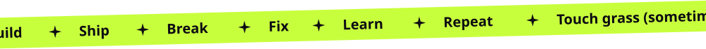

## ✦ The lore

- 🎓 MCA at **SRM IST, Chennai** (class of '27) · BCA from **Assam Don Bosco University**
- 🛠️ I build **full-stack web apps**, **mobile apps** and the occasional **ML model**
- 🏆 My team's travel app **SafarNama** took home a **Special Jury Award**
- 💼 Did a **Full-Stack Web Development internship** at **EdXcellence** (Jan – Mar 2026)
- 🍳 Right now: shipping my capstone **Wanderlens**, leveling up **PinchPop**, learning **RAG**
- 🧠 DSA daily. Placements loading...
- 💬 Ask me about React, Node / Express, MongoDB, Supabase or Java
- 🎨 Side interests: design and Indian stories

## ✦ Main quests

Stuff I actually built. Tap a card to open the repo.

<a href="https://github.com/devKiNGCRiC/wanderlens"></a>

  <a href="https://github.com/devKiNGCRiC/PinchPop"></a>
  <a href="https://github.com/devKiNGCRiC/dsa-interactive-visualizer"></a>
  <a href="https://github.com/devKiNGCRiC/SafarNama"></a>
  <a href="https://github.com/devKiNGCRiC/UniAthleteIQ"></a>
  <a href="https://github.com/devKiNGCRiC/DevBlog"></a>
  <a href="https://github.com/devKiNGCRiC/WanderLink"></a>

  <b>▶ Live right now:</b>&nbsp;
  <a href="https://pinchpop.pages.dev/"><b>Play PinchPop</b></a> &nbsp;·&nbsp;
  <a href="https://algovisualizer-pro.vercel.app/"><b>Try AlgoVisualizer Pro</b></a>

<b>TL;DR in plain text</b> (for screen readers and ATS bots 🤖)

 

| Project | What it is | Built with | Link |
|:--|:--|:--|:--|
| **Wanderlens** · MCA capstone | Social app to find community-verified, hyper-local photo spots: feed + map, geo-tagged posts, connections, real-time chat, AI photo-trail planner | React Native · Expo · TypeScript · Supabase (PostGIS, Realtime) · MapLibre · Gemini / Groq | [Repo](https://github.com/devKiNGCRiC/wanderlens) |
| **PinchPop** · Live | Gesture-controlled photobooth game: frame with your fingers, pinch to capture, solve a 3×3 puzzle, keep the polaroid | React · TypeScript · Vite · MediaPipe · Canvas · Web Audio · Tailwind | [Live](https://pinchpop.pages.dev/) · [Repo](https://github.com/devKiNGCRiC/PinchPop) |
| **AlgoVisualizer Pro** · Live | Step-by-step animations of 5 sorting algorithms with live stats and a compare mode | React · TypeScript · Vite · Tailwind · Framer Motion · Zustand | [Live](https://algovisualizer-pro.vercel.app/) · [Repo](https://github.com/devKiNGCRiC/dsa-interactive-visualizer) |
| **SafarNama** · Special Jury Award | Travel platform for underrated and hidden destinations (team project, frontend + backend) | React · Node.js · Express · MongoDB · Maps API | [Repo](https://github.com/devKiNGCRiC/SafarNama) |
| **UniAthleteIQ** · ML research | Ensemble ML model predicting athlete injury risk, ~87K records, SMOTE balancing | Python · XGBoost · SMOTE | [Repo](https://github.com/devKiNGCRiC/UniAthleteIQ) |
| **DevBlog** · Internship | Full-stack blog platform with JWT auth, built at EdXcellence | React · Express · MongoDB · JWT | [Repo](https://github.com/devKiNGCRiC/DevBlog) |
| **WanderLink** · Android | Native Android app for discovering and sharing travel spots | Java · XML · Android Studio | [Repo](https://github.com/devKiNGCRiC/WanderLink) |

## ✦ Side quests

- 🧩 [**DSA in C++**](https://github.com/devKiNGCRiC/DSA-in-CPP-by-KiNG) · [**Java DSA**](https://github.com/devKiNGCRiC/java-practice-dsa) — DSA practice, basics → advanced
- 🌿 [**EcoVibes**](https://github.com/devKiNGCRiC/EcoVibes-Static-Website) — responsive eco-tourism site. EcoVibes → SafarNama → Wanderlens... yeah, travel apps are kinda my thing

## ✦ Now cooking

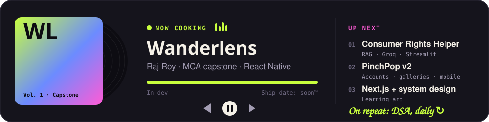

## ✦ Inventory

Tech I've actually used in projects. No wishlist energy.

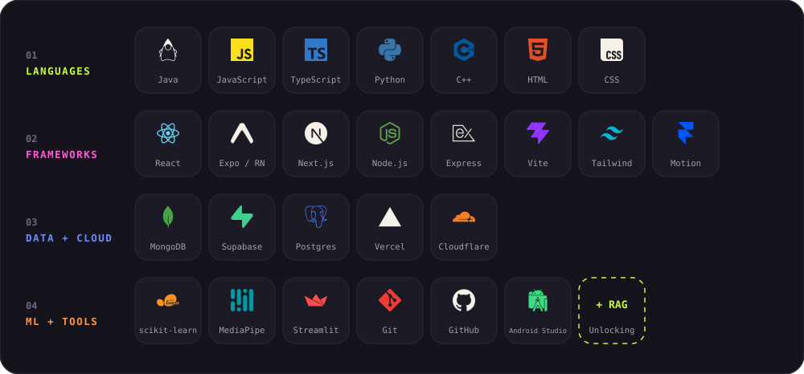

## ✦ Stats

<a href="https://github.com/devKiNGCRiC?tab=repositories">
  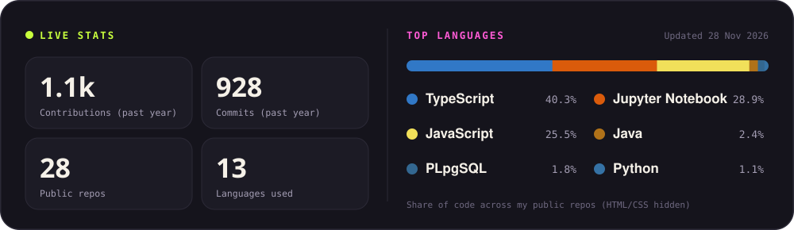
</a>

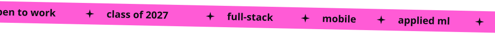

<a href="https://www.linkedin.com/in/raj-roy-kc2806/">
  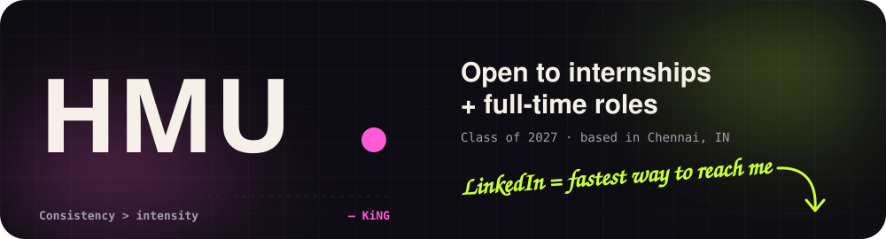 intensity, KiNG." />
</a>

  

